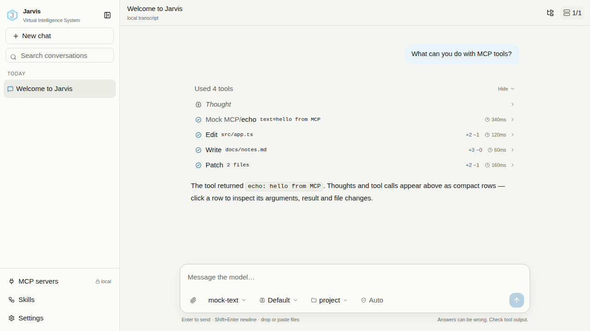
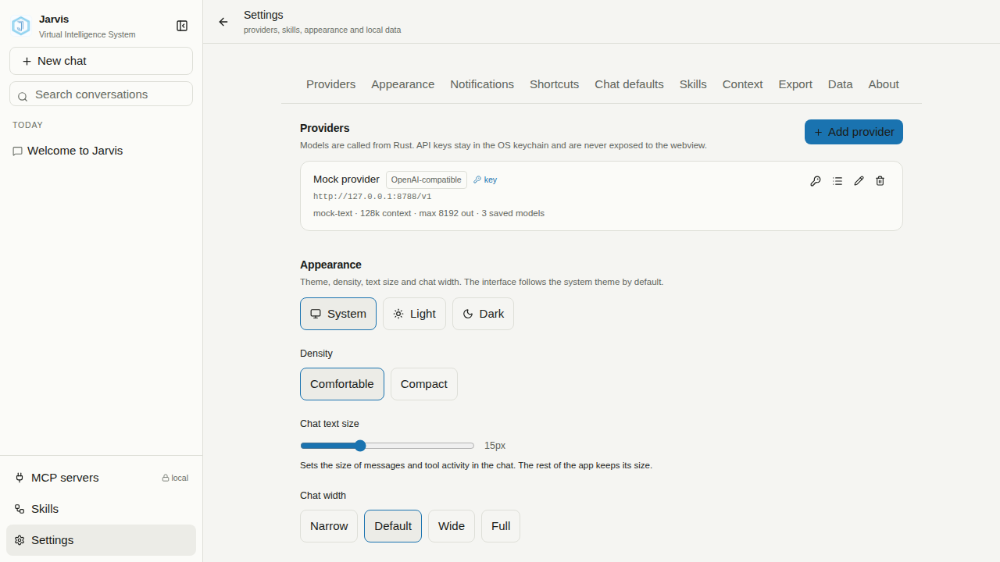
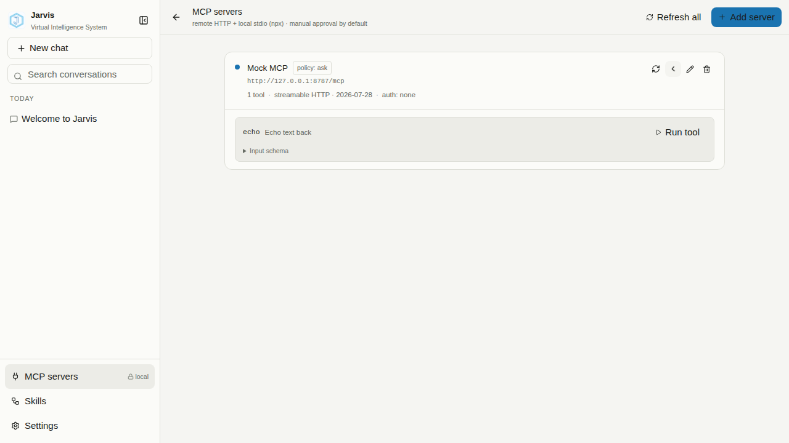

# Jarvis

**A local-first desktop AI agent that can actually use your tools.**

Bring your own model. Connect the MCP servers you already trust. Keep your keys, transcripts, workspaces and approvals on your machine.

[](https://github.com/arijumadi/mcp-chat/releases/latest)
[](https://github.com/arijumadi/mcp-chat/actions/workflows/build.yml)
[](LICENSE)



Jarvis is not another chat wrapper. It runs the agent loop locally, connects to real tools over MCP, and asks before anything touches your files or runs a command.

## Why Jarvis

### Your model, your key

Use OpenAI-compatible endpoints or Anthropic. Point it at a cloud API, Ollama, LM Studio, or your own gateway. API keys stay in the OS keychain and never come back to the webview.

### Tools that actually do things

Connect remote MCP servers or local `stdio`/`npx` servers. Browse, search, query databases, control a browser, manage GitHub, run a spreadsheet workflow, or hand work to another agent. Jarvis discovers the tools and calls them inside the conversation.

### Local-first by default

Transcripts live in SQLite on your machine. There is no account, cloud sync, telemetry or crash reporting. Network traffic goes through the Rust core, not the webview. Update checks are the only optional GitHub request and can be turned off.

### Approval-first safety

Read-only tools can run automatically. Writes, shell commands and MCP calls follow per-server policies. Workspace file mutations preview a diff before approval, and dangerous shell commands still require confirmation even in Auto mode.

### Built for long work

Reasoning effort from Default to Max, context compaction, steering, background subagents, attachments, file diffs and per-chat workspaces. Jarvis can keep working without turning the chat into a wall of noise.

## What you can do

**Code in a real workspace.** Open a project, let Jarvis read and edit files, run tests, inspect diffs and keep each conversation in its own workspace.

**Turn MCP into a control plane.** Keep a small catalog of tools in context, then call only what you need. Batch independent calls, fetch a schema before guessing arguments, and enforce approvals at the target server.

**Run a research or operations desk.** Connect search, databases, internal APIs and automation tools. Use attachments, long-running subagents and compacted context to work through a task instead of one prompt at a time.

**Work with real office files.** Bundled skills create, read and edit Word `.docx`, PDF and Excel `.xlsx` files, with form filling, tracked changes, PDF merging/stamping, spreadsheet formulas and CSV interop. One `spreadsheet` skill handles both safe workbook auditing and authoring. Antigravity CLI users can also delegate one-shot coding tasks to `agy`.

**Browse and comment on the workspace.** Open the files panel to browse the conversation workspace with a lazy, resizable tree; inspect source with line numbers and syntax highlighting, preview images, or switch markdown between source and rendered views; select one or more lines; and attach a comment directly to the next message. The composer keeps the file context as chips you can edit or remove, so the model receives the path, line range, preview and comment without pasting a whole file.

**Hand a chat to an external agent.** Jarvis speaks the Agent Client Protocol, so OpenCode, Codex, Gemini CLI and Antigravity CLI can run a conversation end to end. Add one in Settings, press **Test** to prove the command actually works on that machine, then pick it in the composer. Pass its slug to the `subagent` tool instead to run the same agent as a background worker and keep Jarvis in charge. An ACP agent brings its own model, tools, sign-in and history, so Jarvis's system prompt, skills and MCP catalog do not apply to a chat it owns, and slash commands come from the agent itself. Choose whether it may auto-approve read-only work or must ask for every call.

**Use subscription-backed agent runtimes.** OAuth 2.0 + PKCE with dynamic client registration, loopback callback, refresh tokens and keychain storage. Designed for subscription-backed servers such as T3 Code.

## At a glance

| | |
|---|---|
| **Models** | OpenAI-compatible `/chat/completions`, Anthropic `/v1/messages` |
| **MCP transports** | Streamable HTTP 2026-07-28, legacy 2025-11-25, HTTP+SSE, local stdio |
| **MCP auth** | OAuth 2.0 + PKCE, static bearer, `X-API-Key` |
| **Local tools** | shell, Python, read, grep, glob, edit, apply_patch, write, skills, question, subagent |
| **ACP agents** | OpenCode, Codex, Gemini CLI, Antigravity CLI over ACP v1; whole chat or background subagent, ask or auto-approve reads |
| **Bundled skills** | docx, pdf, spreadsheet, excalidraw, antigravity-cli, manage-skill |
| **Safety** | per-server policy, per-call approvals, diff preview, shell guard, workspace confinement |
| **Platforms** | Windows, Linux and macOS from source; Windows NSIS and Linux packages published |
| **Privacy** | no telemetry, no account, no cloud transcript sync |

## Install

### Download

Get the latest build from **[GitHub Releases](https://github.com/arijumadi/mcp-chat/releases/latest)**.

- **Windows:** NSIS installer. Existing 0.3.24+ installs can self-update.
- **Linux:** AppImage or `.deb`. AppImage self-updates; `.deb` is managed by your package manager.
- **macOS:** build from source with the steps below.

### Build from source

Requirements: Node.js 22+, pnpm 10+, Rust 1.90+, and the [Tauri v2 prerequisites](https://v2.tauri.app/start/prerequisites/).

```bash
pnpm install
pnpm tauri dev
```

On Debian/Ubuntu/Mint:

```bash
sudo apt update
sudo apt install libwebkit2gtk-4.1-dev build-essential curl wget file \
  libxdo-dev libssl-dev libayatana-appindicator3-dev librsvg2-dev
```

Building on a headless machine? Follow **[RUN-ON-DESKTOP.md](RUN-ON-DESKTOP.md)**.

## First five minutes

1. **Add a provider.** Open **Settings → Add provider**. Use any OpenAI-compatible base URL, or Anthropic. For a local model, point it at Ollama or LM Studio; localhost keys are optional.
2. **Add an MCP server.** Open **MCP servers → Add server**. Use an HTTPS endpoint, or a local `npx` command for stdio. Test the connection. For OAuth, choose **OAuth 2.0**, click **Save and connect**, and approve the browser sign-in.
3. **Start a chat.** Pick a workspace from the composer, attach files if needed, and ask for something real.

No MCP server yet? Jarvis still works as a local-first chat and coding agent with its built-in tools.

## Screenshots

| Chat with activity and tools | Settings |
|---|---|
|  |  |

| MCP servers | Skills |
|---|---|
|  |  |

## Security model

- No accounts, cloud sync, telemetry or crash reporting.
- All network I/O happens in Rust. The webview never calls provider or MCP endpoints.
- API keys, MCP bearer tokens and OAuth sessions live in the OS keychain (`com.mcpchat.app`), not SQLite or `localStorage`.
- Update checks are optional and send no message content or identifiers.
- Markdown raw HTML is disabled, links open in the system browser, and remote images are not loaded.
- MCP URLs must use HTTPS, except loopback during development. Local stdio servers run as child processes with your user permissions; only add commands and packages you trust.
- CSP is strict; `connect-src` is limited to Tauri IPC.

Read the full [security notes](ARCHITECTURE.md) and the [feature reference](docs/FEATURES.md).

<details>
<summary><strong>Keyboard shortcuts</strong></summary>

`Ctrl` on Windows and Linux, `Cmd` on macOS.

| Shortcut | Action |
|---|---|
| `Ctrl/Cmd+Shift+P` | Command palette |
| `Ctrl/Cmd+K` | Search chats; type `>` for the palette |
| `Ctrl/Cmd+N` | New chat |
| `Ctrl/Cmd+Shift+K` | Compact the conversation |
| `Ctrl/Cmd+Shift+M` | Switch model |
| `Ctrl/Cmd+Shift+O` | Switch workspace |
| `Ctrl/Cmd+B` | Toggle the sidebar |
| `Ctrl/Cmd+,` | Settings |
| `Esc` | Stop the current turn from the message box |
| `Ctrl/Cmd+Enter` | Allow the pending tool call once |
| `Ctrl/Cmd+Shift+Enter` | Always allow the pending tool call |
| `Ctrl/Cmd+Backspace` | Reject the pending tool call |
| `Enter` / `Shift+Enter` | Send / newline |

Approval shortcuts never fire while typing in a text field.
</details>

## Development

```bash
pnpm install
pnpm check       # lint, typecheck, Vitest, build, fmt, Rust tests, clippy
pnpm test:e2e    # Playwright smoke, interaction and visual tests
pnpm tauri dev
```

The repository includes a mock MCP/LLM server for integration tests:

```bash
cargo run -p mcp-mock
```

Current verification: **257 Vitest tests, 249 Rust tests and 74 Playwright tests** pass. The native Tauri bundles are built by the tag workflow on Windows and Linux.

## Documentation

| Document | What it covers |
|---|---|
| [Feature reference](docs/FEATURES.md) | Every user-facing capability and edge case |
| [Architecture](ARCHITECTURE.md) | Agent loop, MCP negotiation, storage, prompt and security decisions |
| [Packaging](PACKAGING.md) | Windows, macOS and Linux installers, signing and updates |
| [Desktop setup](RUN-ON-DESKTOP.md) | Moving a headless build onto a desktop |
| [Releases](https://github.com/arijumadi/mcp-chat/releases) | Downloadable builds and release notes |

## License

MIT. See [LICENSE](LICENSE).
