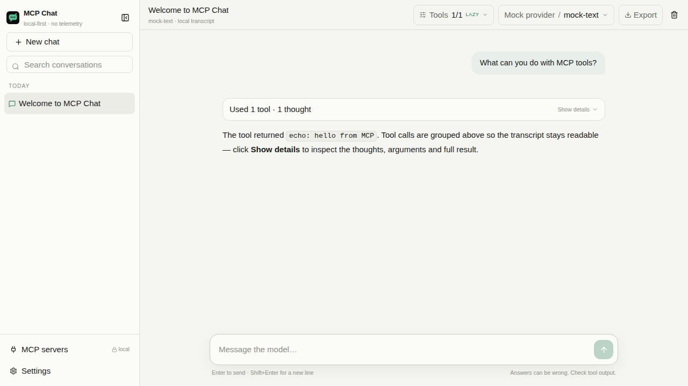
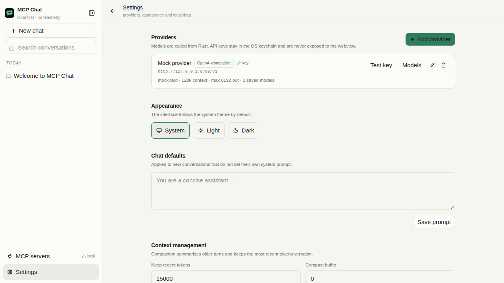
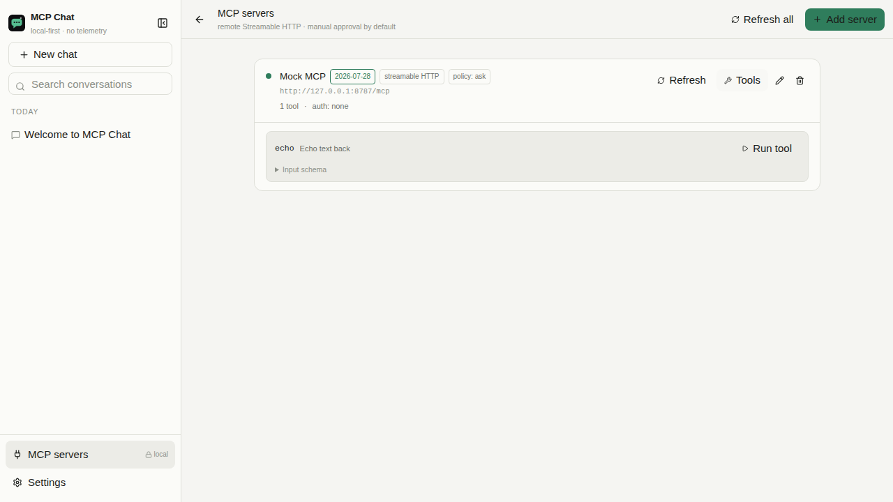

# MCP Chat

A local-first desktop chat app for OpenAI-compatible and Anthropic models, with **remote MCP tools**, explicit approvals, and no telemetry.



## What works (M0–M5)

- Streaming chat from any OpenAI-compatible `/chat/completions` endpoint and from Anthropic `/v1/messages`.
- Local SQLite transcripts with full-text search, inline rename, delete, regenerate and stop.
- Remote MCP over **Streamable HTTP 2026-07-28** (stateless headers, `server/discover`, request-scoped SSE progress, MRTR input), with legacy **2025-11-25** `initialize` fallback and deprecated **HTTP+SSE** fallback.
- The model can call discovered MCP tools inside a normal turn. Tool calls and reasoning are grouped into a collapsible “Used N tools · N thoughts” summary with the final answer below; detail cards stream live (`queued → running → ok / error`) and run in parallel (max 4).
- Per-chat MCP server selection and **direct vs lazy** tool delivery. New chats default to lazy mode: a compact server/tool/argument catalog goes in the system prompt, and the model calls `mcp_call_tool` directly (`mcp_get_tool_schema` only when it needs full JSON Schema; `mcp_search_tools` only when the catalog is truncated). `mcp_execute` runs up to 8 independent MCP calls in one step (4 in flight), so a multi-tool answer does not need many model round trips. Approval and policy checks still apply to each real target.
- Context meter per chat, live prompt/completion usage in the composer, manual compaction, token-based retention (~15k recent by default) and a 15%/16k compaction buffer.
- Provider models are fetched once in the provider form and saved with the provider; the chat model picker uses that saved list. Model is optional on the provider.
- Approval policies per server (`auto` / `ask` / `deny`), “allow once”, “always allow” rules, rejection with feedback delivered back to the model.
- Tool output is capped at 8k characters for the model, the full payload spills to disk, and a built-in `read_tool_output` tool pages it back in 50k-character chunks without re-truncating the page.
- Token-based compaction on context overflow, `finish_reason: length` continuations, retries with backoff, interrupted-stream continuation.
- Markdown with code blocks (language label, copy, horizontal scroll), tables, reasoning sections and a strict no-raw-HTML renderer.
- Providers, keys and MCP servers are managed from the UI. API keys live in the OS keychain; the webview never receives them back.

Not in this batch: OAuth 2.1/DCR (M6) and packaging (M7). Static bearer tokens and an `X-API-Key` header (stored in the OS keychain) for MCP work.

## Tool loading and context

Use the **Tools** button in the chat header to choose which MCP servers this conversation may use and how their tools are delivered. New conversations default to **lazy**; existing conversations are migrated to lazy once and can be switched back:

- **Direct schemas** — every tool from the selected servers is sent to the model on every step. Best for small catalogs.
- **Lazy catalog + call** — the model gets a compact catalog of servers, tool names, short descriptions and argument summaries, plus `mcp_call_tool`, `mcp_get_tool_schema` and `mcp_execute`. It calls one target directly, or batches up to 8 independent targets in a single `mcp_execute` call; it only falls back to `mcp_search_tools` if the catalog was truncated. This avoids the old search→schema→call loop. Approvals and server policy still apply to every real target.

The same panel shows an approximate context meter, the automatic compaction threshold, and a **Compact now** action. The composer also shows live prompt/completion usage while a turn runs. Context defaults mirror OpenCode V2: keep the most recent ~15k tokens, compact with a 15%-of-window buffer (minimum 16k). Both values are configurable in **Settings → Context management**.

## Quickstart

Requirements: Node.js 22+, pnpm 10+, Rust 1.85+, and the Tauri v2 Linux prerequisites on Linux.

```bash
pnpm install
pnpm tauri dev
```

On Debian/Ubuntu/Mint, the Tauri prerequisites are:

```bash
sudo apt update
sudo apt install libwebkit2gtk-4.1-dev build-essential curl wget file \
  libxdo-dev libssl-dev libayatana-appindicator3-dev librsvg2-dev
```

If you built this on a headless server and need to move it to a desktop, follow **[RUN-ON-DESKTOP.md](RUN-ON-DESKTOP.md)**.

Then in the app:

1. **Settings → Add provider.** For a local OpenAI-compatible server use e.g. `http://127.0.0.1:11434/v1` and a model name; keys are optional for localhost.
2. **MCP servers → Add server.** Use an HTTPS MCP endpoint (or localhost during development), choose a policy and run **Test connection**.
3. Create a chat and ask the model to use one of the server's tools.

## Mock server walkthrough

The repository ships an axum mock that implements three MCP transport generations plus a scripted LLM provider. It is the same server used by the Rust integration tests.

```bash
cargo run -p mcp-mock
```

It prints:

```
MCP 2026-07-28 : http://127.0.0.1:8787/mcp
MCP 2025-11-25 : http://127.0.0.1:8789/mcp
MCP HTTP+SSE   : http://127.0.0.1:8790/sse
OpenAI-compat  : http://127.0.0.1:8788/v1
```

Add a provider with base URL `http://127.0.0.1:8788/v1` and model `mock-tool`. Add an MCP server with URL `http://127.0.0.1:8787/mcp`, auth **none**, policy **ask**. Send “Use the echo tool to say hello”, then approve the call.

The mock exposes:

| Tool | Behaviour |
|---|---|
| `echo(text)` | returns `echo: <text>` |
| `add(a, b)` | returns `structuredContent.sum` |
| `slow_progress(seconds)` | emits three progress notifications on the POST SSE stream |
| `fail()` | returns JSON-RPC error `-32603` |
| `elicit(question)` | returns MRTR `input_required`; retry carries the form response |
| `big(n)` | returns 50 KB of text, forcing spill + `read_tool_output` |
| `header_echo(region)` | mirrors `region` into `Mcp-Param-Region` (x-mcp-header) |
| `sleep(seconds)` | test-only delayed tool used by the cancellation test |

Provider model names select scripted scenarios: `mock-text`, `mock-tool`, `mock-parallel`, `mock-length`, `mock-cut`, `mock-overflow`, `mock-weird-finish`, `mock-elicit`, `mock-big`, `mock-slow`, `mock-fail`, `mock-header`, `mock-always-tool`, `mock-badjson`, `mock-flaky`. See `tests/mock_servers/src/provider.rs`.

## Verification

Everything below **was run in this repository** on Linux without a GUI/WebKit development environment:

```bash
pnpm lint          # ESLint
pnpm typecheck     # TypeScript
pnpm test          # Vitest: 11 tests
pnpm build         # Vite production build
pnpm fmt:check     # cargo fmt --check
pnpm core:test     # 25 unit + 24 agent + 6 MCP integration + 1 auth + 1 provider test = 57 Rust tests
pnpm core:clippy   # cargo clippy -p mcp-chat-core --all-targets -- -D warnings
pnpm mock:clippy   # same for the mock server
pnpm test:e2e      # Playwright: 4 smoke tests against vite preview with a stubbed IPC bridge
```

`pnpm check` runs all of the above except Playwright.

The Rust tests cover the acceptance matrix: split tool arguments, two parallel calls, invalid arguments, unknown tools, `finish_reason: length`, a cut stream, context overflow + compaction, manual compaction/context status, per-chat server selection, lazy MCP catalog/schema/call, batch execute, read_tool_output paging, unknown finish reason, policy denial, user rejection with feedback, crash sweep, progress notifications, MRTR elicitation, output spill/paging, max steps, cancellation during a tool, and retryable provider errors.

**What is not verified on this machine:** the Tauri shell itself could not be compiled or launched here because the machine has no WebKit/GTK development headers and no display. `pnpm tauri dev` is the intended path on a desktop with the prerequisites above. The frontend was verified in a browser through Playwright using a stubbed IPC bridge; screenshots are from that harness, not the native window. No real provider API key was used for automated tests; the keychain path is exercised with an in-memory store in tests.

## Screenshots

| Settings | MCP servers |
|---|---|
|  |  |

## Keyboard shortcuts

| Shortcut | Action |
|---|---|
| `Ctrl/Cmd+N` | New chat |
| `Ctrl/Cmd+K` | Quick switcher |
| `Enter` | Send |
| `Shift+Enter` | Newline |
| `Esc` | Stop the current turn |

## Privacy and security

- No accounts, cloud sync, telemetry or crash reporting.
- All network I/O happens in Rust. The webview never calls LLM or MCP endpoints.
- API keys and MCP bearer tokens are stored in the OS keychain (`com.mcpchat.app`), not SQLite or `localStorage`.
- Markdown raw HTML is disabled, links are opened in the system browser, and remote images are not loaded.
- MCP server URLs must be HTTPS, except loopback for development.
- Request logs never include message content; `Authorization`/`Cookie` values are not logged.
- CSP is strict and `connect-src` is limited to Tauri IPC. The only deviation from the prompt's CSP is the required `ipc:` / `http://ipc.localhost` entries for Tauri's invoke bridge; it is documented in `ARCHITECTURE.md`.

## Repository layout

```
crates/mcp-chat-core/   db, llm, mcp, secrets, agent loop (testable without Tauri)
src-tauri/              thin Tauri shell: commands, events, capabilities
src/                    React 19 + TypeScript + Tailwind 4 renderer
tests/mock_servers/     axum MCP + OpenAI/Anthropic mock server
e2e/                    Playwright smoke tests
docs/screenshots/       UI captures from the mock bridge
```

## Scope and next steps

M6 (OAuth 2.1 + PKCE + DCR + loopback + refresh/Reconnect) and M7 (packaging, export dialog, final polish) are not implemented. See `ARCHITECTURE.md` for the known gaps and the protocol decisions.
